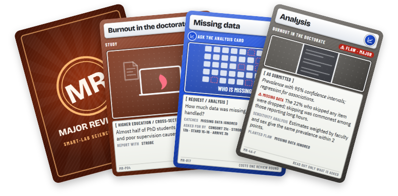

# Major Revisions

A deduction card game for scientists: **find the flaw hidden in the manuscript before your review rounds run out.**
The second game of the **[SMART-Lab Science Game Kit](https://ua-smartlab.github.io/science-game-kit/)** (after [Methodical](https://github.com/UA-SMARTLab/methodical-card-game)), card games that
help researchers refresh their research-methods knowledge.



A fictional study is dealt as five face-down cards: Question, Method, Sample, Measurement, Analysis. One or two carry
a planted flaw: a volunteer-only sample, an outcome switched after registration, assessors who knew the groups,
missing data quietly dropped. Reviewers spend a limited number of requests (flow diagram, registration, blinding,
coding tree…) to reveal answers, then name the flawed card and give the verdict an editor would: Accept, Minor
revisions, Major revisions or Reject. Every request points to the reporting-guideline item that asks for it
(CONSORT 2025, STROBE, PRISMA 2020, COREQ, STARD 2015, ARRIVE 2.0), so the game also teaches where to look.

## What's in the box

| | |
|---|---|
| 8 Study cards | an RCT, a cohort, a case-control study, a cross-sectional survey, an interview study, a diagnostic accuracy study, a systematic review and an animal experiment |
| 94 Manuscript cards | each study's five parts, sound and in one or two flawed versions, with 37 types of documented flaw (8 Reject, 28 Major, 18 Minor) |
| 24 Request cards | each tied to the checklist items that require it |
| 4 Verdict cards, 3 reference cards | |
| 195 different flawed manuscripts | every study with one or two of its cards flawed |

Every study is fictional and says so; every flaw type, reference and checklist item is real and was checked (see
[DESIGN.md](DESIGN.md) §6).

## Start here

- **Play online:** **[ua-smartlab.github.io/major-revisions-card-game/app](https://ua-smartlab.github.io/major-revisions-card-game/app/)**. Nothing to install.
- **Play offline:** double-click `play-windows.bat` (Windows), `play-mac.command` (Mac) or `play-ubuntu.sh`
  (Ubuntu), or open [`app/index.html`](app/index.html). No installation and no server; it works offline once the
  fonts are cached.
- **Print a prototype:** open [`print/cards.html`](print/cards.html) in Chrome and print at 100% on A4 with background
  graphics on, then cut. [`print/backs.html`](print/backs.html) has the card backs;
  [`print/answer-key.html`](print/answer-key.html) is the Author's flaw key.
- **Rules:** [RULES.md](RULES.md). **Design notes and sources:** [DESIGN.md](DESIGN.md). **Flaw key as text:**
  [ANSWER_KEY.md](ANSWER_KEY.md).

## Editing the cards

All card text lives in `data/`; the code never contains card text.

| File | Holds |
|---|---|
| `data/meta.json` | title, the five slots, the four verdicts, scoring |
| `data/studies.json` | each study: claim, guideline, and per slot the *As submitted* line and one or two answers (`request`, `sound`, and optionally `flaw: {type, severity, text, why}`) |
| `data/requests.json` | each request: the slot it is asked of, what it asks, and its checklist items per guideline |
| `data/flaws.json` | each flaw type, with the paper that documents it |
| `data/guidelines.json` | the reporting guidelines, their checklists and key papers |

Then rebuild and check:

```
python tools/build.py         # validates the data, writes app/, print/, ANSWER_KEY.md and i18n/en/cards.json
python tools/check_cards.py   # renders every card at print size in headless Chrome/Edge; fails if one overflows
python tools/test_app.py      # plays the app headless: dealing, verdict rule, scoring, a full review
```

The build fails on errors (unknown ids, a flaw whose catching request has no item in the study's guideline, a card
with too few flawable slots) and warns about weak spots (text long enough to crowd a card, unused flaws or requests).
Generated files are never edited by hand. Python standard library only.

## Languages

Major Revisions plays in English, French, Dutch, German and Arabic: the app has a language picker, and each language
has its own app page and print deck, `app/<code>/` and `print/<code>/` (English is `app/` and `print/`). English is the
source. The i18n structure is the kit's: interface strings in `i18n/en/ui.json`, card text generated into
`i18n/en/cards.json`; add a language by listing it in `i18n/languages.json` and translating copies of both files into
`i18n/<code>/` (anything missing falls back to English).

Each translation uses the same terms as Methodical and Red Flag for shared concepts, was checked by an independent
methodologist review, and fits every card, picture labels included. Each `i18n/<code>/GLOSSARY.md` records the term
choices, their sources and the questions a native-speaking methodologist should still settle.

## Status

v0.1, a playable and checked prototype in five languages, public and playable online. See [NIGHT-LOG.md](NIGHT-LOG.md)
for what was checked and `DESIGN.md` for what is open.

## Licence

Content CC BY-NC-SA 4.0, code PolyForm Noncommercial 1.0.0. Copyright © 2026 Abdulhamid Baghdadi, developed at
SMART-Lab, Universiteit Antwerpen. Commercial use only with written permission. See [LICENSE.md](LICENSE.md).
